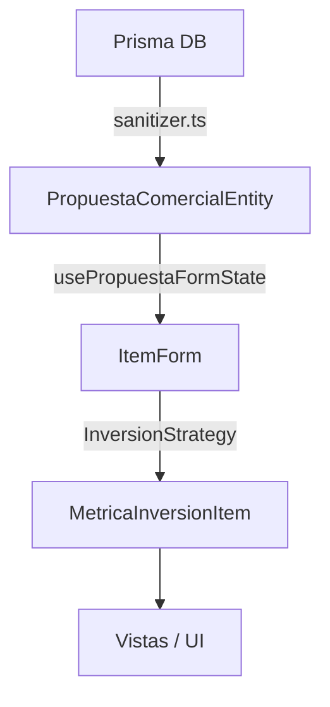

# Arquitectura de Tipos de Datos (`propuesta.types.ts`)

El sistema de tipos del módulo de propuestas organiza el flujo de datos desde la base de datos hasta la interfaz del usuario y los cálculos matemáticos de inversión.

---

##  Capas de Datos

### 1. Dominio / BBDD (`PropiedadBase`, `ParqueIndustrialEntity`)
Representan las entidades crudas deserializadas desde Prisma.
- `PropiedadBase`: Estructura unificada para inmuebles (incluye relaciones con `zona`, `parqueIndustrial` e `imagenes`).
- Utiliza tipos numéricos nativos (`number`) para precios y superficies (gracias a la sanitización).

### 2. Formulario y Estado Local (`ItemForm`)
Representa la estructura plana utilizada por los formularios de edición y hooks (`usePropuestaFormState`).
- Contiene los parámetros editables por el usuario (costo de obra, superficie proyectada, porcentaje de anticipo, notas de logística).
- Soporta atributos de preventa (`esPreventa`, `mesesEntrega`).

### 3. Entidad de Propuesta (`PropuestaItemEntity` y `PropuestaComercialEntity`)
- `PropuestaItemEntity`: Extiende de `ItemForm` añadiendo los identificadores (`id`, `propuestaId`) y el objeto relacional `propiedad: PropiedadBase`.
- `PropuestaComercialEntity`: Estructura completa de la propuesta (cliente, slug, tipo, ubicación de referencia, payload JSON de recomendaciones e ítems).

### 4. Estrategia de Inversión y Métricas (`MetricaInversionItem`, `MetricasInversionResult`)
Tipos generados por la estrategia financiera (`InversionStrategy`) tras procesar los ítems del formulario:
- Contiene los resultados numéricos calculados (superficie de nave proyectada, costo total de obra, ROI anual, desglose de cuotas y desembolso inicial).

---

## 🔄 Diagrama del Flujo de Datos

```markdown
`[Prisma DB]` ➔ `(sanitizer.ts)` ➔ `[PropuestaComercialEntity]` ➔ `[ItemForm]` ➔ `[InversionStrategy]` ➔ `[MetricaInversionItem]` ➔ `(Vistas / UI)`
```

